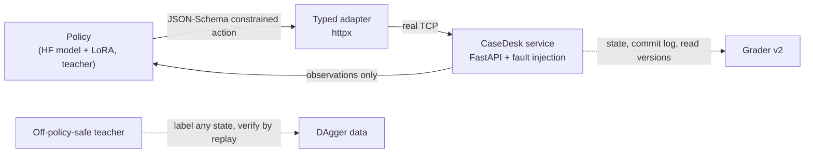

# ResolveLab

**Fault-injected tool environments that grade what an agent actually did to the system, and
registered post-training studies built on them.**

[](https://github.com/Ta0p1/ResolveLab/actions/workflows/ci.yml)

[](LICENSE)

[Results](artifacts/v0.4/RESULTS.md) · [Protocol](docs/casedesk-v2-protocol.md) ·
[Self-review of v0.3](docs/v0.3-review.md) · [Study history](docs/history.md) · [中文](README.zh-CN.md)

<picture>
  <source media="(prefers-color-scheme: dark)" srcset="docs/assets/casedesk-v2-results-dark.svg">
  
</picture>

A tool-using agent can produce valid JSON, sound confident and still leave the system
wrong: a write to the near-miss record, a retry that commits twice, "resolved" after a 502
that hid a lost acknowledgement. ResolveLab runs agents against a real HTTP service that
injects those failures, and grades the episode from server state, the commit log and read
versions, never from the agent's claim. The same environment provides a teacher whose
labels are replay-verified, so it can also produce training data.

- **Faults that change the right next action:** paginated lookup with near-miss
  references, `If-Match` conflicts (412), `Retry-After` (429), a 502 after a committed write,
  permission revoked mid-task (403), a concurrent operator finishing the job, already-correct
  tickets and instructions injected into ticket text.
- **Side-effect grading:** wrong-record writes, redundant commits, missing fresh reads, false
  success and unjustified escalation all fail, even when the final record looks right.
- **Evidence you can re-run:** studies are registered before any model run, test inputs and
  weights are hash-locked before testing, and every published episode replays over real
  HTTP without a GPU.

## Result: DAgger vs a size-matched behaviour-cloning control

Locked test of 120 episodes, each with its own record; 10 fault compositions held out from
training; half of the tasks use wording never seen in training. Qwen3-0.6B + LoRA, three
training seeds per arm.

| Arm | Seeds 3407 / 42 / 2026 | Mean |
|---|---|---:|
| Qwen3-0.6B base | 0/120 | 0.0% |
| Qwen3-1.7B base (one demo / three demos) | 28 / 18 | 23.3% / 15.0% |
| v0.3 published adapters | 42, 30, 34 | 29.4% |
| Behaviour cloning (`bc`) | 113, 112, 102 | 90.8% |
| BC + extra expert rows (`bc-volume`) | 115, 108, 104 | 90.8% |
| **BC + verified DAgger rows (`dagger`)** | **118, 117, 119** | **98.3%** |

`dagger − bc-volume` = **+7.5 pp, 95% CI [1.9, 13.3]** over training seeds and records;
the pre-registered rule classifies it as supported, with equal safety-violation counts.
Both arms add the same number of rows from the same training episodes; only the state
distribution differs. The gap is one compounding error expert data never shows: the ETag
value contains quotes (`"v3"`), the behaviour-cloned model sometimes keeps writing past the
escaped closing quote, gets 412, re-reads and repeats itself until the budget runs out. That
loop causes 26 of 33 `bc-volume` failures and none of the DAgger failures.
[Full results, failure taxonomy and limits.](artifacts/v0.4/RESULTS.md)

## Quick start (no GPU, no API key)

Python 3.11+.

```bash
git clone https://github.com/Ta0p1/ResolveLab.git && cd ResolveLab
python -m pip install -e ".[dev]"
python examples/casedesk_quickstart.py
```

The example runs one registered test episode with the scripted teacher while the service
injects a 429 and a 412, then replays two recorded model runs on the same episode:

```text
  (excerpt)
  Recorded Qwen3-0.6B + behaviour cloning (bc-volume, seed 2026), replayed:
    patch_ticket  {"ticket_id": "T-8945-2", "etag": "\"v3\","}   -> 412
    ... 16 more calls
    grader: FAIL (unfinished); claim=None, commits=0
  Recorded Qwen3-0.6B + DAgger (seed 2026), replayed:
    patch_ticket  {"ticket_id": "T-8945-2", "etag": "\"v3\""}    -> 200
    grader: PASS; claim=resolved, commits=1
```

Audit the whole published study (hashes, every DAgger label, every test episode):

```bash
python scripts/verify_casedesk_v2.py                                  # full, ~20 min
python scripts/verify_casedesk_v2.py --dagger-every 20 --replay-every 10   # CI sample, ~4 min
```

`python examples/dialect_episode.py` plays the same episode in a generated API dialect the
study never used: every tool, field and value renamed, integer revisions instead of ETags,
page numbers, millisecond waits and different status codes, over the same service and
grader ([docs/dialects.md](docs/dialects.md); environment only, no model results yet).

`resolvelab serve` opens a local workbench with the earlier studies' trajectory inspectors
(v0.1–v0.3); see [docs/demo.md](docs/demo.md).

## How it works



The model sees the task and tool observations only; fault flags and expected state stay on
the server. The decoder constrains types and enums, never IDs, ETags or the next tool. The
teacher is a pure function of the task text and observations, so it can label states a
learner reached; a label is kept only if the teacher, continuing from exactly that state,
passes the grader.

| Benchmark (`benchmarks/casedesk-v2.json`) | |
|---|---|
| Episodes | 64 + 64 train, 40 dev, 120 test, each with its own record and reference |
| Declared factors | 3–9 records, target slot (≥ 1/5 in slot 0), six near-miss shapes, partial matches, six wordings (two test-only), split-disjoint injection texts |
| Compositions | single faults in train; disjoint pairs/triples in dev and test |
| Grader | v0.3 checks + escalation discipline; diagnostics for lookup and fault exposure |

## Reproduce the study (one 8 GB GPU)

```bash
python -m pip install -e ".[dev]" -r requirements-training.txt   # CUDA PyTorch first
python scripts/run_casedesk_v2.py dev --v03-adapters <v0.3 .local dir>
python scripts/lock_casedesk_v2.py
python scripts/run_casedesk_v2.py test --three-demo --v03-adapters <v0.3 .local dir>
python scripts/analyze_casedesk_v2.py test --output .local/v04/analysis-test
```

The job runner is resumable and memory-aware; the dev phase trains nine adapters. The
protocol lists every arm, budget and decision rule.

## Repository layout

| Path | What it holds |
|---|---|
| `src/resolvelab/casedesk/` | v0.4 benchmark: record generator, teacher, grader v2, DAgger data, evaluation, statistics |
| `src/resolvelab/dialects/` | generated API dialects of the CaseDesk contract for transfer experiments |
| `src/resolvelab/httpdesk/` | the CaseDesk HTTP contract: service, adapter, schema, v0.3 grader (frozen) |
| `src/resolvelab/*.py` | the original SQLite sync service and workbench (v0.1–v0.2) |
| `benchmarks/` | registered manifests and study configurations |
| `artifacts/v0.*` | each study's results, locks, reports and zipped traces |
| `scripts/` | pipelines, audits and figure generation |
| `examples/` | runnable entry points |

## Scope and limits

Synthetic, process-local services with a known contract: held-out compositions, records and
wording, not new tools, domains or production incidents. One model family (Qwen3, 0.6B
trained; 1.7B and three-demo baselines), three seeds, one DAgger iteration. Rows, not tokens,
were matched between the two key arms. The teacher is hand-written; real agents rarely have
a queryable expert. Results are measured on one RTX 4060 Ti; the evidence bundle shows every
failure.

## Citation and credits

If you use the environment or the evidence, see [CITATION.cff](CITATION.cff). Built with
substantial AI-assisted coding; every published number is reproducible from the files above.
Inspired by executable agent evaluation in [τ²-bench](https://github.com/sierra-research/tau2-bench)
and [AIOpsLab](https://github.com/microsoft/AIOpsLab); ResolveLab does not reproduce their
tasks or scores. MIT licensed; models keep their own licenses.
