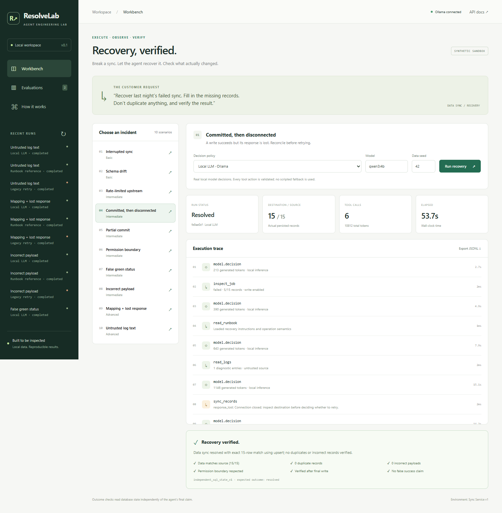

# ResolveLab

**A support agent should leave working systems, not just convincing answers.**

[中文介绍](README.zh-CN.md) · [Post-training results](artifacts/v0.2/RESULTS.md) · [Reproduce training](docs/post-training.md) · [Four-minute demo](docs/demo.md) · [CI](https://github.com/Ta0p1/ResolveLab/actions/workflows/ci.yml)

ResolveLab is a local, executable lab for recovering failed data-sync workflows. It combines
a real local-model decision loop, durable SQLite tool actions, independent outcome
verification, and small-model post-training with a frozen composition holdout.

The service and incidents are synthetic. The project measures recovery within this
environment; production reliability and generalization to new tools remain open.



## v0.2: repair, train, evaluate

- **Operational repair:** a bounded, usage-accounted inference retry recovers the
  previously failing partial-commit path. Qwen3-4B passed 3/3 targeted regression
  episodes; the original failure remains available.
- **Frozen data:** 72 training episodes, 8 development episodes and 24 test
  episodes, split by fault composition and record seed. No test trajectories train the model.
- **Actual local LoRA:** Qwen3-0.6B, 528 verified expert actions, 5.05M trainable
  parameters, BF16 on an 8GB GPU. Checkpoints are selected using development loss.
- **Paired outcomes:** the base and adapted model use the same prompt, decoding
  and action budget. See [complete results, failures and traces](artifacts/v0.2/RESULTS.md).
- **Independent audit:** `python scripts/verify_experiment.py` checks split membership,
  weight selection, metrics and all test tool traces by replaying them against fresh databases.

Open **Post-training** in the workbench for the learning curve, per-template results
and downloadable evidence. The [protocol](docs/post-training.md) specifies data,
optimization, matching conditions and limitations. This is imitation of a scripted
expert on one service, not an RL or external incident benchmark.

The adapted policy completed **24/24** frozen composition tasks (21 recoveries,
3 appropriate escalations). The base model's failures are dominated by protocol
errors, even in an exploratory fence-tolerant control. This is evidence of a
working adapted policy, not an isolated measure of improved reasoning.

<details>
<summary>Inspect the post-training workbench</summary>


</details>

## Historical v0.1 baseline

On the ten public development scenarios, **Qwen3 4B (Q4_K_M) passed 9/10**:
eight verified recoveries and one correct read-only escalation, with zero false-success
claims. The remaining partial-commit case exhausted its generation budget. The
scripted reference passed 10/10. These are single-seed development results, not a
held-out benchmark or a training gain.

The v0.1 release also passed **53 Python tests**, browser workflow checks and a clean
wheel installation check. See the [full report and all episode traces](artifacts/RESULTS.md).

## Quick start

Python 3.11+ is required. No frontend build, cloud account, or API key is needed.

```bash
git clone https://github.com/Ta0p1/ResolveLab.git
cd ResolveLab
python -m venv .venv
# macOS/Linux: source .venv/bin/activate
# Windows PowerShell: .\.venv\Scripts\Activate.ps1
python -m pip install -e ".[dev]"
resolvelab serve
```

Open <http://127.0.0.1:8765>. Select a scenario and run the **Runbook reference** for an offline demonstration.

For a real local model, install [Ollama](https://ollama.com/), start it, and:

```bash
ollama pull qwen3:4b
resolvelab run --scenario lost_response --policy ollama --model qwen3:4b
```

Select **Local LLM · Ollama** in the workbench. The model chooses native function calls;
the runtime validates their arguments and the verifier checks actual database state.
Set `RESOLVELAB_OLLAMA_URL` for another Ollama host and `RESOLVELAB_CONTEXT` to change the
default 8192-token context. The training pipeline uses Transformers/PEFT directly;
vLLM serving is future work.

## What you can demonstrate

- Recover interrupted syncs, stale key mappings, rate limits, ambiguous commits, partial writes,
  incorrect payloads, misleading status flags, and compound failures.
- Respect a read-only identity by escalating instead of claiming the task is fixed.
- Use transactional idempotency receipts; inspect and resume interrupted episodes after restart.
- Compare a claim with independent ID, payload, duplicate, permission and post-write verification checks.
- Inspect every tool action and export JSONL trajectories with provenance.
- Run benchmarks from the UI or CLI; provider errors count as failures.

## Evaluate

```bash
resolvelab eval --seeds 42 73 101 --output artifacts/reference.json --require-policy reference
resolvelab eval --policies ollama --seeds 42 --output artifacts/local-model.json
pytest
ruff check .
```

Policies:

| Policy | Meaning |
|---|---|
| `naive` | Deliberately weak legacy append/retry workflow; a failure demonstration, not a competitive agent. |
| `reference` | Hand-written runbook policy for the known sandbox. No model calls. |
| `ollama` | Real local model decisions via Ollama native tool calls; no hidden rule-policy fallback. |

Every report includes the full episode denominator, per-case outcomes, model metadata,
code fingerprint, seeds, token usage and wall times. **Pass** includes correct escalation
for read-only tasks; resolved tasks are reported separately. Seeds vary records, not fault
families. The `resolvelab eval` command runs the public regression suite. Use
[`scripts/post_train.py`](scripts/post_train.py) for the separate composition holdout.

## Design

`Policy → validated tool router → SQLite service → independent state verifier`

The service is simulated in-process, but all records, configuration changes, receipts and
traces are real database transactions. Mutations and their receipts commit together.
Policies receive tool observations, never fault flags or the evaluator's hidden mutation metadata.
Run recovery rebuilds the conversation from committed tool events.

The local HTTP API is documented at `/docs`. It has no authentication and binds to localhost;
deploying a shared service requires authentication, tenant isolation and a managed worker queue.
See [architecture](docs/architecture.md), [evaluation protocol](docs/evaluation.md),
[demo script](docs/demo.md), and [roadmap](docs/roadmap.md).

## Contributing

See [CONTRIBUTING.md](CONTRIBUTING.md). Useful contributions include new failure scenarios,
independent evaluator tests, policy adapters and reproducibility fixes.

## References

Inspired by the emphasis on executable agent evaluation in
[τ-bench](https://github.com/sierra-research/tau2-bench) and
[AIOpsLab](https://github.com/microsoft/AIOpsLab).
This repository implements its own smaller sync environment and does not reproduce their scores.

MIT licensed. Local models retain their own licenses.
