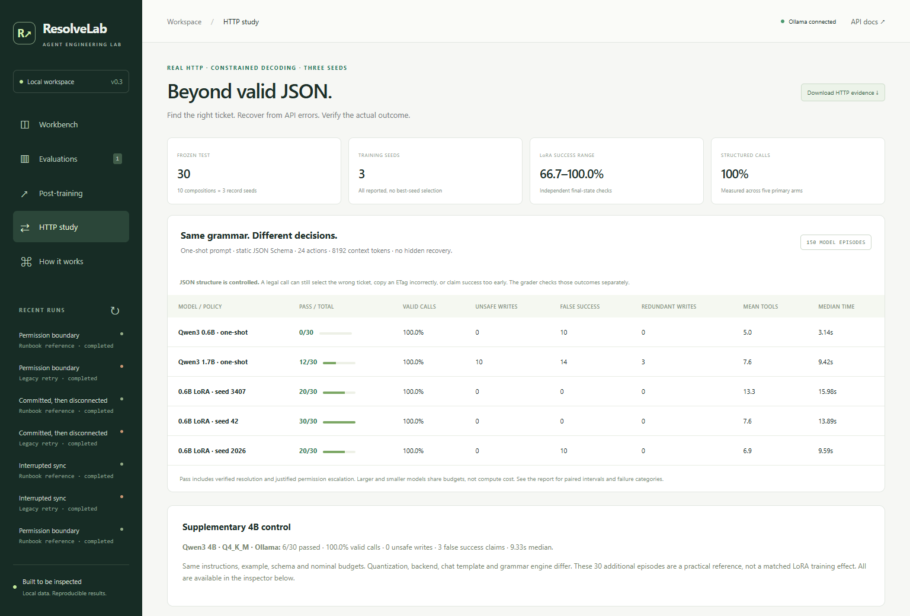
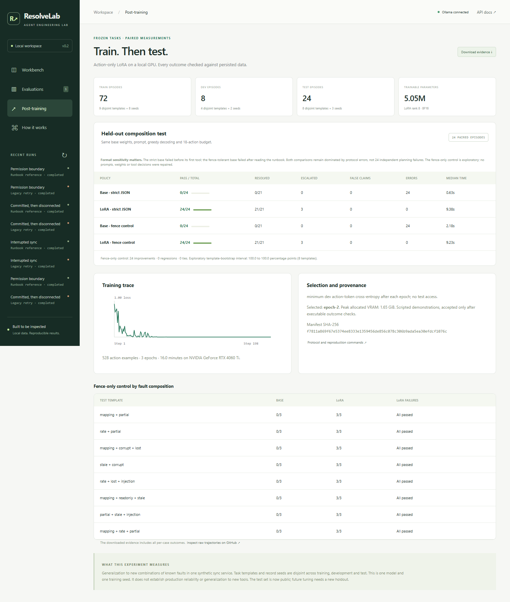

# ResolveLab

**A support agent should leave working systems, not just convincing answers.**

[中文介绍](README.zh-CN.md) · [Latest results](artifacts/v0.4/RESULTS.md) · [v0.3 self-review](docs/v0.3-review.md) · [v2 protocol](docs/casedesk-v2-protocol.md) · [Four-minute demo](docs/demo.md) · [CI](https://github.com/Ta0p1/ResolveLab/actions/workflows/ci.yml)

ResolveLab is an agent engineering lab for recovery workflows across two synthetic
services: a durable SQLite sync system and a ticket service over real HTTP. It combines
local-model tool use, independent outcome checks and small-model post-training with
registered train/development/test splits.

The service and incidents are synthetic. The project measures recovery within this
environment; production reliability and generalization to new tools remain open.



## v0.4: take the v0.3 result apart, then test DAgger against a size-matched control

- **Self-review first.** The v0.3 test was three records reused across ten compositions; the
  matched base never reached a fault; and a counterfactual that moves only the target shows
  the v0.3 adapters solve 54/54 later-page targets with the published demo and 0/54 when the
  demo's target is on page one. They had learned the demo's layout. ([Review](docs/v0.3-review.md))
- **New benchmark.** 288 episodes, each with its own record; target slot, decoy shapes and
  wording are declared factors; half the test uses wording never seen in training.
- **Off-policy-safe teacher.** The v0.3 runbook mislabels learner states (21/91 perturbed
  states). The rewrite recovers from all fuzzed states, and every label is verified by
  finishing the episode from that exact state.
- **Controlled question.** DAgger adds verified labels at the learner's own states;
  `bc-volume` adds the same number of extra expert rows from the same episodes. Registered,
  with decision rules, before any v2 model run; test inputs and adapters locked before testing.

| Test (120 independent episodes) | Seeds 3407 / 42 / 2026 | Mean |
|---|---|---:|
| Qwen3-0.6B base | 0/120 | 0.0% |
| Qwen3-1.7B base (one-shot / three-demo) | 28/120 / 18/120 | 23.3% / 15.0% |
| v0.3 published adapters | 42, 30, 34 | 29.4% |
| Behaviour cloning (`bc`) | 113, 112, 102 | 90.8% |
| BC + extra expert rows (`bc-volume`) | 115, 108, 104 | 90.8% |
| BC + verified DAgger rows (`dagger`) | **118, 117, 119** | **98.3%** |

`dagger − bc-volume` = **+7.5 pp, 95% CI [1.9, 13.3]** over training seeds and records
(registered rule: supported), with equal safety-violation counts. Extra expert data alone
changed nothing. The difference is one compounding error that expert data never shows: a
mis-copied ETag that triggers a self-inflicted 412 loop. 26 of 33 `bc-volume` failures,
0 `dagger` failures. [Full results, failure taxonomy and limits](artifacts/v0.4/RESULTS.md);
audit without a GPU with `python scripts/verify_casedesk_v2.py`.

## v0.3: control JSON structure, then measure outcomes

> Superseded as a headline by the [v0.3 self-review](docs/v0.3-review.md); kept unchanged as
> the registered record.

- **Stronger baselines:** Qwen3-0.6B and Qwen3-1.7B use full tool-schema constrained
  decoding and one verified training demonstration. The LoRA arms use the identical
  prompt, schema and action/token budgets. No model-output repair or rule fallback.
  A separately labeled Qwen3-4B Q4_K_M / Ollama control checks a larger local model.
- **A second API contract:** paginated ticket lookup, exact reference matching,
  If-Match concurrency, idempotency keys, post-commit 502, Retry-After and mid-task
  permission revocation. Calls cross actual TCP sockets through httpx and FastAPI.
- **Repeated local training:** three registered LoRA seeds, 322 verified expert
  actions from 48 training episodes, development-loss checkpoint selection.
- **Fresh test:** 30 new episodes across 10 compositions and 3 disjoint record seeds,
  frozen before model runs.
  Valid-call rate, task success, unsafe writes, false success and unnecessary writes
  are separate measurements. All failures and all training seeds remain visible.
- **Executable evidence:** inspect every model episode in **HTTP study**, or audit
  source/data/weight provenance and replay the published actions with
  `python scripts/verify_http_study.py`—no GPU or model download needed.

<!-- HTTP_RESULTS_START -->

| Policy | Task success | Schema-valid calls | False success |
|---|---:|---:|---:|
| Qwen3-0.6B base | 0/30 | 100.0% | 10 |
| Qwen3-1.7B base | 12/30 | 100.0% | 14 |
| 0.6B LoRA / 3407 | 20/30 | 100.0% | 0 |
| 0.6B LoRA / 42 | 30/30 | 100.0% | 0 |
| 0.6B LoRA / 2026 | 20/30 | 100.0% | 10 |

Supplementary Qwen3-4B Q4_K_M / Ollama: **6/30** passed, **100.0%** schema-valid calls. Different quantization/backend; not a matched training effect.

[Full results, paired intervals and failures](artifacts/v0.3/RESULTS.md).
<!-- HTTP_RESULTS_END -->

[Release validation](artifacts/v0.3/validation.json): 129 tests, all 180 HTTP episode
replays, browser checks and a clean wheel installation passed.

The HTTP backend is synthetic and process-local. This tests composition recovery
within its known contract; it does not demonstrate production reliability or
zero-shot transfer from sync training to a new service. See the
[model card](docs/httpdesk-model-card.md), [architecture](docs/architecture.md) and
[interview notes](docs/interview-notes.md) for exact claims and limits.

<details>
<summary>Earlier studies: v0.1 and v0.2, including the format confound</summary>

## Historical v0.2: repair, train, evaluate

- **Operational repair:** a bounded, usage-accounted inference retry recovers the
  previously failing partial-commit path. Qwen3-4B passed 3/3 targeted regression
  episodes; the original failure remains available.
- **Frozen data:** 72 training episodes, 8 development episodes and 24 test
  episodes, split by fault composition and record seed. No test trajectories train the model.
- **Actual local LoRA:** Qwen3-0.6B, 528 verified expert actions, 5.05M trainable
  parameters, BF16 on an 8GB GPU. Checkpoints are selected using development loss.
- **Paired outcomes:** the base and adapted model use the same prompt, decoding
  and action budget. See [complete results, failures and traces](artifacts/v0.2/RESULTS.md).
- **Independent audit:** `python scripts/verify_experiment.py` checks split membership,
  weight selection, metrics and all test tool traces by replaying them against fresh databases.

Open **Post-training** in the workbench for the learning curve, per-template results
and downloadable evidence. The [protocol](docs/post-training.md) specifies data,
optimization, matching conditions and limitations. This is imitation of a scripted
expert on one service, not an RL or external incident benchmark.

The adapted policy completed **24/24** frozen composition tasks (21 recoveries,
3 appropriate escalations). The base model's failures are dominated by protocol
errors, even in an exploratory fence-tolerant control. This is evidence of a
working adapted policy, not an isolated measure of improved reasoning.

<details>
<summary>Inspect the post-training workbench</summary>



</details>

## Historical v0.1 baseline

On the ten public development scenarios, **Qwen3 4B (Q4_K_M) passed 9/10**:
eight verified recoveries and one correct read-only escalation, with zero false-success
claims. The remaining partial-commit case exhausted its generation budget. The
scripted reference passed 10/10. These are single-seed development results, not a
held-out benchmark or a training gain.

The v0.1 release also passed **53 Python tests**, browser workflow checks and a clean
wheel installation check. See the [full report and all episode traces](artifacts/RESULTS.md).

</details>

## Quick start

Python 3.11+ is required. No frontend build, cloud account, or API key is needed.

```bash
git clone https://github.com/Ta0p1/ResolveLab.git
cd ResolveLab
python -m venv .venv
# macOS/Linux: source .venv/bin/activate
# Windows PowerShell: .\.venv\Scripts\Activate.ps1
python -m pip install -e ".[dev]"
resolvelab serve
```

Open <http://127.0.0.1:8765>. Select a scenario and run the **Runbook reference** for an offline demonstration.
Open **HTTP study** for the recorded constrained-model comparison and per-episode
HTTP inspector. This view contains measured runs; it does not execute live inference.

For a real local model, install [Ollama](https://ollama.com/), start it, and:

```bash
ollama pull qwen3:4b
resolvelab run --scenario lost_response --policy ollama --model qwen3:4b
```

Select **Local LLM · Ollama** in the workbench. The model chooses native function calls;
the runtime validates their arguments and the verifier checks actual database state.
Set `RESOLVELAB_OLLAMA_URL` for another Ollama host and `RESOLVELAB_CONTEXT` to change the
default 8192-token context. The training pipeline uses Transformers/PEFT directly;
vLLM serving is future work.

## What you can demonstrate

- Recover interrupted syncs, stale key mappings, rate limits, ambiguous commits, partial writes,
  incorrect payloads, misleading status flags, and compound failures.
- Respect a read-only identity by escalating instead of claiming the task is fixed.
- Use transactional idempotency receipts; inspect and resume interrupted episodes after restart.
- Compare a claim with independent ID, payload, duplicate, permission and post-write verification checks.
- Inspect every tool action and export JSONL trajectories with provenance.
- Run benchmarks from the UI or CLI; provider errors count as failures.

## Evaluate

```bash
resolvelab eval --seeds 42 73 101 --output artifacts/reference.json --require-policy reference
resolvelab eval --policies ollama --seeds 42 --output artifacts/local-model.json
pytest
ruff check .
```

Policies:

| Policy | Meaning |
|---|---|
| `naive` | Deliberately weak legacy append/retry workflow; a failure demonstration, not a competitive agent. |
| `reference` | Hand-written runbook policy for the known sandbox. No model calls. |
| `ollama` | Real local model decisions via Ollama native tool calls; no hidden rule-policy fallback. |

Every report includes the full episode denominator, per-case outcomes, model metadata,
code fingerprint, seeds, token usage and wall times. **Pass** includes correct escalation
for read-only tasks; resolved tasks are reported separately. Seeds vary records, not fault
families. The `resolvelab eval` command runs the public regression suite. Use
[`scripts/post_train.py`](scripts/post_train.py) for the separate composition holdout.

## Design

`Policy → validated tool router → SQLite service → independent state verifier`

The sync service is simulated in-process, but all records, configuration changes, receipts and
traces are real database transactions. Mutations and their receipts commit together.
Policies receive tool observations, never fault flags or the evaluator's hidden mutation metadata.
Run recovery rebuilds the conversation from committed tool events.

CaseDesk adds `constrained policy → HTTP adapter → ticket service → outcome grader`.
Its HTTP receipts are atomic within one process lifetime, without crash durability.
The model never receives fault flags or expected-state snapshots.

The local HTTP API is documented at `/docs`. It has no authentication and binds to localhost;
deploying a shared service requires authentication, tenant isolation and a managed worker queue.
See [architecture](docs/architecture.md), [evaluation protocol](docs/evaluation.md),
[demo script](docs/demo.md), and [roadmap](docs/roadmap.md).

## Contributing

See [CONTRIBUTING.md](CONTRIBUTING.md). Useful contributions include new failure scenarios,
independent evaluator tests, policy adapters and reproducibility fixes.

## References

Inspired by the emphasis on executable agent evaluation in
[τ-bench](https://github.com/sierra-research/tau2-bench) and
[AIOpsLab](https://github.com/microsoft/AIOpsLab).
This repository implements its own smaller sync environment and does not reproduce their scores.

MIT licensed. Local models retain their own licenses.
