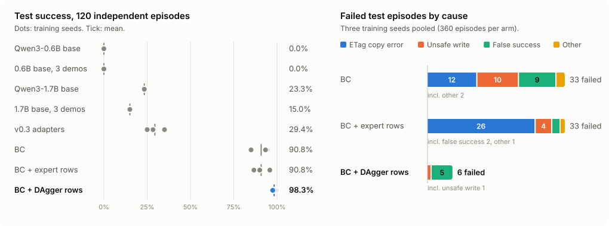

# ResolveLab

**注入故障的工具环境：按 Agent 对系统实际造成的结果评分，并在此之上做预先登记的后训练实验。**

[](https://github.com/Ta0p1/ResolveLab/actions/workflows/ci.yml)

[](LICENSE)

[结果](artifacts/v0.4/RESULTS.md) · [实验方案](docs/casedesk-v2-protocol.md) ·
[v0.3 自我审查](docs/v0.3-review.md) · [实验历史](docs/history.md) · [English](README.md)

<picture>
  <source media="(prefers-color-scheme: dark)" srcset="docs/assets/casedesk-v2-results-dark.svg">
  
</picture>

调用工具的 Agent 可以输出合法 JSON、语气笃定，却仍然把系统弄错：写到了引用很像的另一张工单、
重试导致重复提交、在丢失确认的 502 之后直接宣称"已解决"。ResolveLab 让 Agent 面对一个会注入这些
故障的真实 HTTP 服务，并根据服务端状态、提交日志和读取版本来评分，从不采信 Agent 自己的说法。
同一个环境还提供一个标注经重放验证的老师，因此也能用来生成训练数据。

- **会改变"正确下一步"的故障**：分页查找与相似引用、`If-Match` 冲突（412）、`Retry-After`（429）、
  写入已提交但返回 502、任务中途撤销权限（403）、并发操作者先完成、目标已满足，以及工单文本中的注入指令。
- **按副作用评分**：写错记录、重复提交、缺少最新读取、虚假成功、无依据升级都会判失败，即使最终记录看起来正确。
- **可重跑的证据**：实验在任何模型运行前登记，测试输入和权重在测试前按哈希锁定，每个公开回合都能在无 GPU
  的情况下通过真实 HTTP 重放。

## 结果：DAgger 对比等量数据的行为克隆

锁定的测试集共 120 个回合，每个回合一条独立记录；10 种故障组合未在训练中出现；一半任务使用训练中从未出现的措辞。
模型为 Qwen3-0.6B + LoRA，每组三个训练种子。

| 方案 | 种子 3407 / 42 / 2026 | 均值 |
|---|---|---:|
| Qwen3-0.6B 基线 | 0/120 | 0.0% |
| Qwen3-1.7B 基线（单示范 / 三示范） | 28 / 18 | 23.3% / 15.0% |
| v0.3 已发布 adapter | 42、30、34 | 29.4% |
| 行为克隆 `bc` | 113、112、102 | 90.8% |
| 行为克隆 + 额外专家数据 `bc-volume` | 115、108、104 | 90.8% |
| **行为克隆 + 经验证的 DAgger 数据 `dagger`** | **118、117、119** | **98.3%** |

`dagger − bc-volume` = **+7.5 个百分点，95% 区间 [1.9, 13.3]**（同时重抽训练种子和记录），按预先登记的
规则判定为成立，两组安全违规数相同。两组从同一批训练回合加入同样数量的行，唯一区别是状态分布。差距来自
专家数据里从未出现的一种累积错误：ETag 的值本身带引号（`"v3"`），行为克隆的模型有时会在转义的结束引号后
继续往下写，收到 412，重新读取后再犯同样的错，直到预算用完。这个循环造成了 `bc-volume` 33 个失败中的
26 个，DAgger 为 0。[完整结果、失败分类与局限](artifacts/v0.4/RESULTS.md)。

## 快速上手（无需 GPU 和 API key）

需要 Python 3.11+。

```bash
git clone https://github.com/Ta0p1/ResolveLab.git && cd ResolveLab
python -m pip install -e ".[dev]"
python examples/casedesk_quickstart.py
```

示例先用脚本老师跑一个登记的测试回合（服务注入 429 和 412），再重放两个模型在同一回合上的真实记录：
行为克隆在 `"\"v3\","` 处收到 412 并陷入循环，DAgger 写入 `"\"v3\""` 后通过。

审计整个公开实验（哈希、全部 DAgger 标注、全部测试回合）：

```bash
python scripts/verify_casedesk_v2.py                                       # 完整版，约 20 分钟
python scripts/verify_casedesk_v2.py --dagger-every 20 --replay-every 10   # CI 抽样版，约 4 分钟
```

`python examples/dialect_episode.py` 会在一个实验从未用过的生成式 API 方言里跑同一个回合：工具、字段和取值全部改名，
用整数版本号代替 ETag、用页码分页、以毫秒等待、状态码也不同，但服务和评分器不变（见 [docs/dialects.md](docs/dialects.md)；
目前只有环境，还没有模型结果）。

`resolvelab serve` 会打开本地工作台，里面是早期实验（v0.1–v0.3）的轨迹查看页面，见 [docs/demo.md](docs/demo.md)。

## 评测你自己的模型

```bash
resolvelab casedesk run --episode test-test_conflict_rate-07 --model ollama:qwen3:4b
resolvelab casedesk eval --pool dev --model ollama:qwen3:4b --output runs/qwen3-4b-dev.json
resolvelab casedesk eval --pool dev --model openai:<model> --option base_url=http://localhost:8000/v1 --output runs/vllm-dev.json
resolvelab casedesk eval --pool dev --model anthropic:claude-opus-5-5 --output runs/opus-dev.json   # 需 pip install "resolvelab[anthropic]"
```

所有模型看到的都是实验同一套提示、示范和工具接口；报告和轨迹格式与公开证据一致，中断后可续跑。
支持本地 Transformers（`hf:`）、Ollama、任何 OpenAI 兼容服务和 Claude。各选项以及哪些结果能和登记实验
直接比较，见 [docs/models.md](docs/models.md)。

## 工作原理

模型只能看到任务和工具返回；故障开关和期望状态都留在服务端。解码器只约束类型和枚举值，从不约束 ID、ETag
或下一步工具。老师是任务文本和工具返回的纯函数，因此可以为学习者到达的任意状态给出标注；只有当老师从该状态
继续完成并通过评分器时，这条标注才会保留。架构图和基准规格见 [英文 README](README.md#how-it-works) 与
[实验方案](docs/casedesk-v2-protocol.md)。

**作为强化学习环境**：`CaseDeskEnv` 以 `reset` / `step` / `state` 逐步暴露同一个服务，奖励来自评分器 v2
（稀疏、可验证），测试集需显式开启；测试保证它能逐一复现公开的模型轨迹。`python examples/casedesk_env_loop.py`
展示训练器会看到的奖励（开发集上老师为 1.0，随机策略为 0.0）。[环境接口说明](docs/environment.md)。

## 复现实验（单张 8 GB GPU）

```bash
python -m pip install -e ".[dev]" -r requirements-training.txt   # 先装 CUDA 版 PyTorch
python scripts/run_casedesk_v2.py dev --v03-adapters <v0.3 的 .local 目录>
python scripts/lock_casedesk_v2.py
python scripts/run_casedesk_v2.py test --three-demo --v03-adapters <v0.3 的 .local 目录>
python scripts/analyze_casedesk_v2.py test --output .local/v04/analysis-test
```

## 范围与局限

合成的、进程内的服务，接口已知：测试的是没见过的故障组合、记录和措辞，不是新工具、新领域或生产事故。只有一个
模型系列（Qwen3，训练 0.6B；1.7B 和三示范为基线）、三个种子、一轮 DAgger。两个关键组按行数对齐，不是按 token
数。老师是手写的规则，真实场景里很少有可随时查询的专家。结果在一张 RTX 4060 Ti 上测得，证据包公开了所有失败。

## 引用与致谢

引用方式见 [CITATION.cff](CITATION.cff)。项目开发中大量使用了 AI 辅助编程；所有公开数字都可以用上述文件复现。
受 [τ²-bench](https://github.com/sierra-research/tau2-bench) 和 [AIOpsLab](https://github.com/microsoft/AIOpsLab)
的可执行评测思路启发，但不复现它们的任务或分数。MIT 许可；模型遵守各自许可证。
