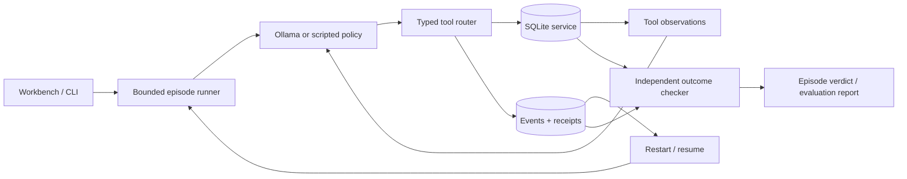

# Architecture

ResolveLab v0.1 is one Python process, one local SQLite database, an optional Ollama
process, and a static browser UI. The domain is intentionally narrow: recover a
failed data sync while preserving data correctness and respecting access limits.

## Boundaries

| Component | Responsibility | Does not do |
|---|---|---|
| `scenarios.py` | Seed records and inject known failure families | Generate production traffic |
| `policies.py` | Choose one action from observations | Read database state or fault flags |
| `tools.py` | Validate arguments, enforce permissions, perform atomic operations | Decide whether the overall task passed |
| `verification.py` | Inspect final persisted data and evidence | Trust natural-language claims |
| `runner.py` | Enforce the 18-action budget, persist events, resume history | Fall back from a model to rules |
| `evaluation.py` | Run isolated episodes and write complete denominators | Exclude model/provider failures |
| `api.py` | Local workbench and API | Provide a multi-user hosted service |

## Tool and data semantics

Each episode owns separate source rows, destination rows, receipts, configuration
and events under an opaque run ID. The source is immutable through the tool API.
Destination records deliberately permit duplicate IDs so the benchmark can detect
the consequences of unsafe append/retry behavior.

The nine tools are `inspect_job`, `read_logs`, `read_runbook`, `configure_sync`,
`sync_records`, `verify_sync`, `wait_retry`, `escalate`, and `finish`. They accept
strict Pydantic arguments and reject unknown properties. There is no arbitrary
shell, SQL execution, network fetch or permission override tool.

The runtime uses `BEGIN IMMEDIATE` to serialize SQLite mutations. A write, its
idempotency receipt, updated service state and tool event share one transaction.
This is a local transactional guarantee, not an exactly-once guarantee for remote
services.

An operation key is scoped to one episode and bound to the sync mode and active
key mapping. Reusing the same key with the same request returns the stored receipt.
Changing its request produces an idempotency conflict. A partially committed batch
remains partial when replayed; the agent must reconcile data and use a new
operation for the remaining work. Upsert fixes existing records without adding
duplicate IDs; append does not.

## Recovery and outcome checks

A lost-response fault commits an operation but returns an ambiguous connection
failure. A partial-commit fault writes half the records before returning that
failure. The model does not receive the internal `mutated` flag that identifies
the actual side effect.

The outcome checker reads source and destination independently and checks missing
IDs, extra IDs, duplicate counts and payload equality. A resolved claim also
requires a successful `verify_sync` after the latest mutation. A read-only task
passes only with an escalation ticket, an `escalated` claim and unchanged records
and configuration.

On server startup, queued/running episodes become interrupted. Resume reconstructs
the model conversation from committed tool events. This also handles a crash
between a tool commit and a conversation checkpoint. A network request may be
reissued after a process crash before its tool action; remote exactly-once
inference is not promised.

## Local inference

Ollama receives native function definitions and assistant/tool messages. Each
response must contain one tool call. The runtime rejects missing, multiple or
unknown tool calls, validates arguments and records failures. The model chooses
the action; there is no scripted-policy fallback.

The baseline requests thinking enabled, temperature 0.6, generation seed 42,
8192 context tokens and at most 2048 output tokens per call. Generated token
usage includes the provider's reported generation count. Raw model reasoning is
not displayed or exported; the trace records chosen actions and tool observations.
Ollama hardware and software changes can affect repeatability.

v0.2 permits one additional inference request when a generation ends at its token
limit with zero tool calls. That request permits 4096 output tokens and includes
a concise protocol reminder. No service action is replayed. Returned token usage
from both attempts is retained; other protocol errors still fail immediately.

The optional Transformers policy uses strict JSON actions and Qwen's non-thinking
template, with identical settings before and after LoRA. Training, model loading
and evaluation are explicit CLI operations; the lightweight workbench does not
import PyTorch. See [post-training.md](post-training.md) for the split, loss and
checkpoint-selection contracts. Source fingerprints distinguish the original
Ollama baseline, training launch and paired evaluation implementations.

## Scope and operation

The server binds to `127.0.0.1` and rejects cross-origin mutation requests. Use one
server process per data directory. Inference requests are serialized within that
runner to avoid competing for a small local GPU. Evaluations run in a background
thread and write reports by atomic file replacement.

Do not expose this unauthenticated development server to a public network. A
production extension needs authentication, explicit tenant boundaries, job leases,
a managed worker queue, per-tool timeouts and real external service adapters.
These are future work, not properties of this release.
