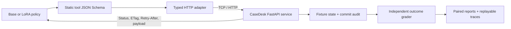
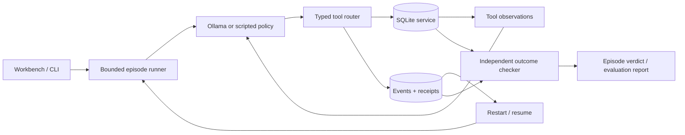

# Architecture

ResolveLab has two synthetic services: a durable SQLite sync sandbox and a ticket
service reached through a real HTTP adapter. The local workbench presents recorded
experiments and interactive sync runs. Optional Transformers/PEFT workers train and
evaluate CaseDesk policies on a local CUDA GPU.

## CaseDesk HTTP boundary (v0.3)

`httpdesk/adapter.py` knows the API routes and headers, but has no access to fault
flags, expected outcomes or server state. It performs one request per action, with
no hidden retry or recovery. The model sees the task, one verified training example
and tool observations. Its grammar always allows all six tools and does not inject
known IDs, ETags, cursors or correct arguments into decoding constraints.

The backend serializes requests with a lock. A successful PATCH and its idempotency
receipt are created atomically within that process. A receipt binds key, path, body
and If-Match. Conflicting reuse returns 409; stale ETags return 412. A fault may
commit then return 502. Retry-After uses a deterministic virtual clock, advanced by
an explicit HTTP tool action. Permission can be revoked between a GET and PATCH.

This backend is a **synthetic process-lifetime service**, not durable remote storage.
State/receipts do not survive its restart. The adapter exercises real TCP requests,
not an in-process mock transport. Evaluation starts an isolated bound socket for
each episode; `scripts/serve_casedesk.py` also runs it as a separate process for
manual inspection. No fixture/admin API is exposed to the model.

`httpdesk/grading.py` reads the server's records and commit/read audit independently
of model text and scripted teacher decisions. It checks the exact target, requested
values, all unrelated payloads, fresh read verification, unnecessary commits and
justified escalation. The backend's permitted concurrent update is accounted for
separately from agent mutations. It does not use the agent's own verification claim
as a ground-truth label. Published replay re-executes every test model action through
HTTP and compares the resulting observations, records and verdict.

The two services have distinct tool contracts. The v0.3 adapter is trained on
CaseDesk data; success there is **not** a zero-shot transfer result from sync training.
See [the registered protocol](httpdesk-protocol.md).

## SQLite sync boundary (v0.1–v0.2)

## Boundaries

| Component | Responsibility | Does not do |
|---|---|---|
| `scenarios.py` | Seed records and inject known failure families | Generate production traffic |
| `policies.py` | Choose one action from observations | Read database state or fault flags |
| `tools.py` | Validate arguments, enforce permissions, perform atomic operations | Decide whether the overall task passed |
| `verification.py` | Inspect final persisted data and evidence | Trust natural-language claims |
| `runner.py` | Enforce the 18-action budget, persist events, resume history | Fall back from a model to rules |
| `evaluation.py` | Run isolated episodes and write complete denominators | Exclude model/provider failures |
| `api.py` | Local workbench and API | Provide a multi-user hosted service |

## Tool and data semantics

Each episode owns separate source rows, destination rows, receipts, configuration
and events under an opaque run ID. The source is immutable through the tool API.
Destination records deliberately permit duplicate IDs so the benchmark can detect
the consequences of unsafe append/retry behavior.

The nine tools are `inspect_job`, `read_logs`, `read_runbook`, `configure_sync`,
`sync_records`, `verify_sync`, `wait_retry`, `escalate`, and `finish`. They accept
strict Pydantic arguments and reject unknown properties. There is no arbitrary
shell, SQL execution, network fetch or permission override tool.

The runtime uses `BEGIN IMMEDIATE` to serialize SQLite mutations. A write, its
idempotency receipt, updated service state and tool event share one transaction.
This is a local transactional guarantee, not an exactly-once guarantee for remote
services.

An operation key is scoped to one episode and bound to the sync mode and active
key mapping. Reusing the same key with the same request returns the stored receipt.
Changing its request produces an idempotency conflict. A partially committed batch
remains partial when replayed; the agent must reconcile data and use a new
operation for the remaining work. Upsert fixes existing records without adding
duplicate IDs; append does not.

## Recovery and outcome checks

A lost-response fault commits an operation but returns an ambiguous connection
failure. A partial-commit fault writes half the records before returning that
failure. The model does not receive the internal `mutated` flag that identifies
the actual side effect.

The outcome checker reads source and destination independently and checks missing
IDs, extra IDs, duplicate counts and payload equality. A resolved claim also
requires a successful `verify_sync` after the latest mutation. A read-only task
passes only with an escalation ticket, an `escalated` claim and unchanged records
and configuration.

On server startup, queued/running episodes become interrupted. Resume reconstructs
the model conversation from committed tool events. This also handles a crash
between a tool commit and a conversation checkpoint. A network request may be
reissued after a process crash before its tool action; remote exactly-once
inference is not promised.

## Local inference

Ollama receives native function definitions and assistant/tool messages. Each
response must contain one tool call. The runtime rejects missing, multiple or
unknown tool calls, validates arguments and records failures. The model chooses
the action; there is no scripted-policy fallback.

The baseline requests thinking enabled, temperature 0.6, generation seed 42,
8192 context tokens and at most 2048 output tokens per call. Generated token
usage includes the provider's reported generation count. Raw model reasoning is
not displayed or exported; the trace records chosen actions and tool observations.
Ollama hardware and software changes can affect repeatability.

v0.2 permits one additional inference request when a generation ends at its token
limit with zero tool calls. That request permits 4096 output tokens and includes
a concise protocol reminder. No service action is replayed. Returned token usage
from both attempts is retained; other protocol errors still fail immediately.

The optional Transformers policy uses strict JSON actions and Qwen's non-thinking
template, with identical settings before and after LoRA. Training, model loading
and evaluation are explicit CLI operations; the lightweight workbench does not
import PyTorch. See [post-training.md](post-training.md) for the split, loss and
checkpoint-selection contracts. Source fingerprints distinguish the original
Ollama baseline, training launch and paired evaluation implementations.

## Scope and operation

The server binds to `127.0.0.1` and rejects cross-origin mutation requests. Use one
server process per data directory. Inference requests are serialized within that
runner to avoid competing for a small local GPU. Evaluations run in a background
thread and write reports by atomic file replacement.

Do not expose this unauthenticated development server to a public network. A
production extension needs authentication, explicit tenant boundaries, job leases,
a managed worker queue, per-tool timeouts and real external service adapters.
These are future work, not properties of this release.
