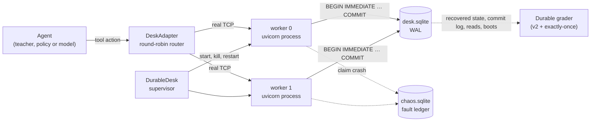

# Durable recovery

The CaseDesk service of v0.3–v0.5 keeps its records and idempotency receipts in one process's
memory, so a restart loses both. `resolvelab.durable` runs the same HTTP contract and graders on
a persisted store, inside real uvicorn worker processes that crash, restart and race each other.

This is an engineering environment (experiment `casedesk-durable-v1`), not a registered study.
No model has been run on it, nothing was trained or selected on it, and no published result,
lock, manifest or snapshot changes.

## What stays the same

- The endpoints are `httpdesk.service.create_app`, imported unchanged: pagination, ETags,
  receipts, status codes and the CaseDesk faults (`conflict`, `lost_ack`, `rate_limit`, `revoke`,
  `injection`, `already_done`, `concurrent_resolve`) behave exactly as in the study.
- The agent side is the CaseDesk adapter, schema, prompt, 24-action budget and v2 teacher.
- Records come from the v2 generator (`WorldState`), so an episode spec has the v2 format plus
  `workers`.
- Tests hold the durable service to the in-memory one: four registered v2 episodes (two of them
  also on two workers) give identical observations, v2 verdicts, commits and final records, and
  published v0.4 model traces, failed episodes included, replay to identical observations and
  verdicts.

No file under `httpdesk/`, `casedesk/` or `dialects/` changes; `main.py`, which is outside the
study core, gains the `durable` command.

## How it is built



**Store** (`durable/store.py`). One SQLite file in WAL mode with `synchronous=FULL` holds the
records, receipts and rate-limit window (service state), the virtual clock, permission, consumed
faults and the oracle's expected records (environment state), and an append-only audit: HTTP
events, commits (with their idempotency key), reads, escalations and process boots.

**One transaction per request** (`durable/service.py`). The frozen handlers do all their work
inside `with state.lock:`. Here that lock is a database transaction: entering takes SQLite's write
lock with `BEGIN IMMEDIATE` and loads the state, leaving writes back what the handler changed and
commits. Because the write lock is taken before the receipt is checked, two workers cannot both
pass the check and both commit; the receipt table's primary key on the idempotency key is a
second guard. A commit is on disk before the response exists.

**Workers** (`durable/worker.py`). `python -m resolvelab.durable.worker` records its boot and the
version of every record it recovered, binds a loopback port and serves until it is killed or
reaches a crash point.

**Supervisor** (`durable/desk.py`). `DurableDesk` creates the episode's store from its spec and
starts one or two workers. A worker that died is restarted on the same store after the request
that found it dead, as an orchestrator would. Kills are SIGKILL (TerminateProcess on Windows),
sent to the interpreter itself. When the episode ends, every worker is killed and the store is
recovered once more, so the grader always judges the state that survives a restart. Requests go
round-robin over the workers' current addresses; the agent never sees ports or worker numbers.

## Process faults

Each fires once per episode. The crash points sit on the commit of the first request that
writes a ticket, and claim their fault in a separate ledger database before the process dies, so
a crash fires once across workers even when its own transaction is about to be lost.

| Fault | When | The agent sees | On the store |
|---|---|---|---|
| `crash_before_commit` | writes staged in the open transaction, then `os._exit(70)` | no response: `status 0`, `commit_state: unknown` | nothing: no write, receipt or event; a re-read shows the old ETag |
| `crash_after_commit` | after `COMMIT`, before the handler returns: `os._exit(71)` | no response | write and receipt durable; the 200 is stored as not delivered |
| `restart_after_commit` | every worker killed once the first writing request has been answered | the next request fails (`ConnectError`), later ones reach the restarted service | unchanged |
| `duplicate_delivery` | every PATCH sent to both workers at the same instant | one worker's response | one commit; the other worker returns the saved receipt |

The suite composes them with the CaseDesk faults: 14 compositions × 2 episodes, listed by
`resolvelab durable episodes`. `duplicate_delivery` is not composed with a crash or `lost_ack`,
since the agent would see whichever duplicate won the race and the trace would not replay. The
scripted teacher passes all 28 (`resolvelab durable suite`, about a minute).

## Durable grader

`grade_durable` runs grader v2 unchanged on the recovered store, then requires:

- **No duplicate commits.** An idempotency key commits at most once (`duplicate_key_commits`),
  and v2's `redundant_commits` stays zero.
- **No lost acknowledged commits.** Each boot after the first records the version of every record
  it recovered. A commit is lost when a later boot recovered an older version of its ticket; it
  was acknowledged when a PATCH for its key was answered 200 and the response was delivered. The
  final recovery counts as a boot.
- **A fresh read after restart.** A resolved claim needs v2's fresh verifying read, served after
  the episode's last restart.

New failure categories: `duplicate_commit`, `lost_acknowledged_commit`, `unverified_after_restart`.

## What the tests show

| Case | Result |
|---|---|
| Crash after commit, then the same key replayed on the restarted worker | the saved 200, one commit |
| The same replay with the process-local store (v0.3 behaviour) | a second commit for the key: `duplicate_commit` |
| Crash before commit | no write, receipt or event; the same key then commits once |
| Restart after an acknowledged write | the next request fails, the restarted service has the write |
| The same restart with the process-local store | the write is gone: `lost_acknowledged_commit` |
| Four PATCHes on two workers, one key | four 200s, one commit |
| Four PATCHes, a key each, one ETag | one 200, three 412s, one commit |
| Four PATCHes, one key, two bodies | two 200s, two 409s, one commit |
| The same-key race with the process-local store | one commit per worker |

In the races the winning worker holds the write lock for a few hundred milliseconds before
committing, so the other requests are certain to arrive while its transaction is open.

Two plausible wrong recoveries, each the teacher with one step replaced
(`durable/counterexamples.py`):

- **Re-read for a fresh ETag and write again under a new key** without checking the values:
  after a crash after commit it commits twice and fails (`redundant_write`). After a crash
  before commit the same retry is correct, and passes.
- **Claim success after a request without a response**, without reading again: after a crash
  after commit the write did land, but the claim is unverified (`unverified_after_restart`);
  after a crash before commit it is a `false_success`.

An immediate retry with the stale ETag under a new key is accepted: If-Match turns it into a
412. In this contract the ETag already stops a blind retry from committing twice. What the
persisted receipt adds is that a retry of the same request gets its original answer instead of
a 412, across restarts and workers, and that a restart cannot reset the records under it.

## Running it

```bash
resolvelab durable episodes
resolvelab durable run --episode durable-crash_after-00
resolvelab durable run --episode durable-crash_after-00 --policy new_key_retry
resolvelab durable run --episode durable-restart-00 --store process
resolvelab durable run --episode durable-race-00 --keep .local/durable/race-00
resolvelab durable suite
resolvelab durable race
python examples/durable_recovery.py
```

`--keep` leaves the store, the fault ledger and every worker's log in a directory for
inspection. `--model provider:model` runs a model instead of a scripted policy, with the
providers of `resolvelab casedesk`.

```python
from resolvelab.durable.episodes import episodes_by_id
from resolvelab.durable.runner import run_durable_episode

trace = run_durable_episode(episodes_by_id()["durable-crash_before_after-00"])
trace["verdict"]["passed"], trace["boots"]
```

## Limits

- One machine and one SQLite file: workers are processes, not nodes. No network partitions,
  clock skew or replication.
- A crash is a process exit; the operating system and disk survive it. `synchronous=FULL` syncs
  every commit, but power loss and torn writes are not tested.
- Crash points are at the commit of the first writing request only. A crash in the middle of a
  handler, or after part of a response was sent, is not modelled.
- Restarts always follow a write and are visible to the agent, so in the registered
  compositions a fresh read after the last write is also after the last restart; the separate
  check is exercised on hand-made stores.
- Error names in observations come from httpx and can differ by operating system.
- Every episode starts processes, so it takes about two seconds; on Windows a refused loopback
  connection takes about two more.
- The prompt is the study's, which explains a 502 but not a request without a response. No model
  has been evaluated here.
